# Report sul funzionamento di enigmaZ3

## 1. Scopo del progetto

enigmaZ3 e un simulatore della macchina Enigma con un cracker incrementale. Il progetto combina:

- simulazione della cifratura Enigma a tre rotori;
- riflettore e plugboard configurabili;
- ring settings e meccanismo storico di double-stepping;
- ricerca delle posizioni iniziali dei rotori;
- recupero di un plugboard parzialmente o completamente sconosciuto;
- ricerca dell'ordine dei rotori e dei ring settings;
- solver SMT Z3, ricerca numerica e ranking euristico;
- CLI, API HTTP e frontend browser.

La macchina lavora sull'alfabeto `A-Z`. Gli spazi, la punteggiatura e gli altri caratteri vengono rimossi durante `process()`.

## 2. Struttura principale

```text
enigma/
  rotor.py       Rotori, cablaggi, notch e ring settings
  reflector.py   Riflettori B e C
  plugboard.py   Scambio delle coppie di lettere
  machine.py     SimpleEnigma ed EnigmaMachine
cracker/
  simple_cracker.py  Cracker Z3 per un solo rotore
  full_cracker.py    Cracker completo e ranking
scripts/
  enigma_cli.py      Interfaccia a riga di comando
enigma_http_server.py API HTTP per i frontend
tests/
  test_enigma.py     Test della macchina e dei cracker
```

Le classi e funzioni principali sono esportate dai package `enigma` e `cracker`.

## 3. Componenti della macchina

### 3.1 Rotori

Sono disponibili i rotori storici Wehrmacht `I`, `II`, `III`, `IV` e `V`. Ogni rotore contiene:

- una permutazione di 26 lettere, cioe il cablaggio interno;
- una posizione corrente da `0` a `25`;
- un notch, che determina quando deve avanzare il rotore successivo;
- un ring setting da `0` a `25`;
- una mappa diretta e una mappa inversa.

I notch implementati sono:

| Rotore | Notch |
|---|---|
| `I` | `Q` |
| `II` | `E` |
| `III` | `V` |
| `IV` | `J` |
| `V` | `Z` |

Il progetto rappresenta i rotori nell'ordine `[sinistra, centro, destra]`: il rotore destro e quello veloce, mentre quello sinistro e quello lento.

Per un valore alfabetico `c`, posizione `p`, ring setting `r` e cablaggio `w`, il passaggio diretto e calcolato come:

```text
indice = (c + p - r) mod 26
uscita = (w[indice] - p + r) mod 26
```

Il passaggio inverso usa la permutazione inversa del cablaggio. In questo modo il segnale puo attraversare lo stesso rotore anche nel ritorno dal riflettore.

### 3.2 Ring settings

Il ring setting (`Ringstellung`) sposta elettricamente il cablaggio del rotore rispetto alla posizione visibile. Non cambia il notch usato dal meccanismo di avanzamento, ma modifica la trasformazione del segnale.

I valori accettati sono da `0` a `25`, dove `0` corrisponde all'impostazione base.

### 3.3 Riflettore

Il riflettore devia il segnale dal percorso di andata a quello di ritorno. Sono disponibili:

- riflettore `B`;
- riflettore `C`.

Il riflettore usa una sostituzione fissa e involutiva: applicandola due volte si torna alla lettera originale. Questa proprieta, insieme alla simmetria dei rotori e del plugboard, permette di usare la stessa macchina sia per cifrare sia per decifrare.

### 3.4 Plugboard

Il plugboard, o `Steckerbrett`, scambia coppie di lettere prima e dopo il gruppo dei rotori. Per esempio:

```text
AB,CD,EF
```

significa `A <-> B`, `C <-> D` e `E <-> F`.

Sono ammesse al massimo 13 coppie, anche se storicamente erano comuni 10 coppie. Una lettera non puo comparire in due coppie diverse. Le lettere non collegate rimangono invariate.

Il plugboard viene applicato due volte:

1. all'ingresso del segnale;
2. all'uscita del segnale.

## 4. Avanzamento dei rotori

Prima di elaborare ogni carattere, i rotori avanzano. Il codice implementa il double-stepping:

1. il rotore destro avanza sempre;
2. se il rotore destro si trova sul proprio notch, avanza anche quello centrale;
3. se il rotore centrale si trova sul proprio notch, avanzano sia il centrale sia il sinistro.

La condizione viene valutata sulla posizione precedente all'avanzamento. Questo produce il doppio scatto del rotore centrale nella sequenza corretta.

Esempio con rotori `I, II, III`:

- `II` ha notch `E`, cioe posizione `4`;
- `III` ha notch `V`, cioe posizione `21`;
- se il centrale e su `E`, il centrale e il sinistro avanzano insieme;
- se il destro e su `V`, il centrale avanza;
- il destro avanza comunque.

## 5. Percorso di cifratura

Per la macchina completa il percorso del segnale e:

```text
lettera
  -> plugboard
  -> rotore destro
  -> rotore centrale
  -> rotore sinistro
  -> riflettore
  -> rotore sinistro in senso inverso
  -> rotore centrale in senso inverso
  -> rotore destro in senso inverso
  -> plugboard
  -> lettera cifrata
```

In forma compatta:

```mermaid
flowchart LR
    A[Testo] --> B[Plugboard]
    B --> C[Rotore destro]
    C --> D[Rotore centrale]
    D --> E[Rotore sinistro]
    E --> F[Riflettore]
    F --> G[Rotore sinistro inverso]
    G --> H[Rotore centrale inverso]
    H --> I[Rotore destro inverso]
    I --> J[Plugboard]
    J --> K[Testo cifrato]
```



Il metodo `encrypt_char()` esegue questo percorso per una lettera. Il metodo `process()` ripete l'operazione su tutto il testo dopo averlo convertito in maiuscolo e normalizzato.

## 6. Come si cifra

Per cifrare servono:

- tre rotori e il loro ordine;
- tre posizioni iniziali;
- tre ring settings;
- un riflettore;
- le coppie del plugboard;
- il testo in chiaro.

Esempio Python:

```python
from enigma import EnigmaMachine, Plugboard, Reflector, Rotor

rotors = [
    Rotor.from_name("I", position=5, ring=0),
    Rotor.from_name("II", position=10, ring=0),
    Rotor.from_name("III", position=20, ring=0),
]

machine = EnigmaMachine(
    rotors,
    Reflector.from_name("B"),
    Plugboard([("A", "Z"), ("B", "Y")]),
)

ciphertext = machine.process("HELLOWORLD")
print(ciphertext)
```

Le posizioni vengono mutate durante l'elaborazione. Per riusare la stessa configurazione iniziale bisogna chiamare `reset((5, 10, 20))` prima di una nuova elaborazione.

## 7. Come si decifra

Enigma e una cifratura simmetrica: la decifratura usa la stessa procedura della cifratura, non una funzione separata. Occorre ricreare esattamente lo stesso stato iniziale:

- stesso ordine dei rotori;
- stesse posizioni iniziali;
- stessi ring settings;
- stesso riflettore;
- stesso plugboard.

Dopo aver resettato la macchina, si passa il ciphertext a `process()`:

```python
machine.reset((5, 10, 20))
plaintext = machine.process(ciphertext)
```

Se anche una sola impostazione e diversa, il risultato non sara il testo originale. Il reset e fondamentale perche la posizione dei rotori cambia a ogni carattere.

## 8. `SimpleEnigma`

`SimpleEnigma` e una versione didattica con:

- un solo rotore;
- un riflettore;
- nessun plugboard;
- nessun double-stepping.

Il rotore avanza comunque prima di ogni carattere. Questa classe serve nelle prime fasi del progetto e viene usata da `crack_simple_enigma`, che cerca la posizione iniziale tra le 26 possibilita usando vincoli Z3 e un crib noto.

## 9. Cracking con Z3 e ricerca numerica

Il cracking usa una parte conosciuta del plaintext, chiamata **crib**, e il ciphertext corrispondente. Il crib deve iniziare in corrispondenza dell'inizio del ciphertext considerato.

### 9.1 Ricerca delle posizioni

`crack_rotor_positions()` assume noti:

- i tre rotori;
- l'ordine dei rotori;
- il riflettore;
- i ring settings;
- il plugboard, se presente.

Le tre posizioni iniziali sono variabili intere in `0..25`. Per ogni carattere il cracker costruisce i vincoli del percorso Enigma, compreso l'avanzamento dei rotori e il double-stepping. Z3 cerca un modello che renda uguali tutte le coppie crib/ciphertext.

Se Z3 scade o non produce un modello, e possibile usare un fallback numerico sulle `26^3 = 17.576` combinazioni di posizione.

### 9.2 Plugboard sconosciuto

`crack_with_plugboard()` cerca contemporaneamente:

- le tre posizioni iniziali;
- un numero stabilito di coppie del plugboard.

Per ogni configurazione delle posizioni calcola il comportamento del gruppo rotori e usa un backtracking con vincoli per ricostruire gli scambi coerenti con il crib. Il timeout limita la ricerca completa.

Questa modalita puo restituire `None` se il crib non e sufficiente, se il numero di coppie e errato oppure se il timeout viene raggiunto.

### 9.3 Configurazione completa

`rank_rotor_configurations()` e `crack_full_configuration()` gestiscono i casi in cui non siano noti ordine dei rotori e ring settings.

Il processo e:

1. genera gli ordini possibili di tre rotori dal pool indicato;
2. genera i ring settings indicati oppure tutti i valori `0..25`;
3. prova a risolvere ogni configurazione con Z3 entro un timeout locale;
4. usa, quando necessario, una ricerca numerica esatta;
5. usa una ricerca euristica per ordinare configurazioni parzialmente compatibili;
6. ordina i risultati per mismatch, caratteri corrispondenti e tempo;
7. restituisce il miglior candidato esatto, quando disponibile.

Un candidato contiene rotori, ring settings, posizioni, numero di mismatch, metodo usato e tempo di calcolo.

## 10. Utilizzo da CLI

La CLI si trova in `scripts/enigma_cli.py` e va eseguita dalla root del repository.

### Cifratura

```bash
python scripts/enigma_cli.py encrypt \
  --text "HELLOWORLD" \
  --rotors I,II,III \
  --positions 5,10,20 \
  --rings 0,0,0 \
  --reflector B \
  --plugboard AZ,BY
```

### Decifratura

```bash
python scripts/enigma_cli.py decrypt \
  --text "CIPHERTEXT" \
  --rotors I,II,III \
  --positions 5,10,20 \
  --rings 0,0,0 \
  --reflector B \
  --plugboard AZ,BY
```

`encrypt` e `decrypt` condividono la stessa implementazione: cambia solo il significato dell'input.

### Cracking delle posizioni

```bash
python scripts/enigma_cli.py crack \
  --mode positions \
  --ciphertext "XYZ..." \
  --crib "WETTERBERICHT" \
  --rotors I,II,III \
  --rings 0,0,0 \
  --timeout-ms 3000
```

Output tipico:

```json
{"positions": [5, 10, 20]}
```

### Cracking del plugboard

```bash
python scripts/enigma_cli.py crack \
  --mode plugboard \
  --ciphertext "XYZ..." \
  --crib "WETTERBERICHT" \
  --rotors I,II,III \
  --rings 0,0,0 \
  --num-pairs 3 \
  --timeout-ms 8000
```

### Ricerca completa

```bash
python scripts/enigma_cli.py crack \
  --mode full \
  --ciphertext "XYZ..." \
  --crib "WETTERBERICHT" \
  --rotor-pool I,II,III,IV \
  --ring-candidates 0,0,0 \
  --ring-candidates 2,11,7 \
  --top-k 5 \
  --timeout-ms 8000 \
  --per-config-timeout-ms 120 \
  --heuristic-budget 1200
```

## 11. API HTTP e frontend

`enigma_http_server.py` espone l'API locale, normalmente su `http://127.0.0.1:8765`.

Endpoint principali:

- `GET /health` controlla che il server sia attivo;
- `POST /encrypt` cifra un testo con la configurazione ricevuta;
- `POST /crack` avvia una delle modalita di cracking.

Il frontend usa JavaScript per la simulazione locale. Le operazioni di cracking vengono inoltrate al server Python. La documentazione dei payload JSON si trova in `frontend/BACKEND.md`.

## 12. Validazione e proprieta verificate

La suite `tests/test_enigma.py` verifica tra l'altro:

- round-trip cifratura/decifratura;
- configurazioni con ring settings;
- plugboard vuoto e con molte coppie;
- double-stepping del rotore centrale e sinistro;
- vettore noto `AAAAAAAAAA -> BDZGOWCXLT` con rotori `I,II,III`, riflettore `B` e posizioni `AAA`;
- recupero delle posizioni con Z3;
- recupero di una configurazione con plugboard sconosciuto.

Per eseguire i test:

```bash
pytest tests/ -v
```

Per i controlli di qualita locali:

```bash
./scripts/run_quality.sh
```

## 13. Limiti e considerazioni

- La macchina lavora solo su lettere alfabetiche e rimuove gli altri caratteri.
- La decifratura richiede il reset alle posizioni iniziali corrette.
- Il cracker dipende dalla qualita e dalla lunghezza del crib.
- Un crib troppo corto puo produrre piu candidati compatibili.
- La ricerca completa puo diventare costosa quando si esplorano molti ordini, ring settings e posizioni.
- I timeout non garantiscono che un risultato assente sia matematicamente impossibile: possono indicare che la ricerca non ha avuto tempo sufficiente.
- Il plugboard del simulatore non verifica esplicitamente tutte le coppie duplicate; la validazione piu completa viene effettuata dalla CLI e dalle funzioni del cracker.

## 14. Sintesi del flusso completo

```text
Input testo
  -> normalizzazione A-Z
  -> avanzamento dei rotori
  -> plugboard in
  -> rotori in avanti
  -> riflettore
  -> rotori all'indietro
  -> plugboard out
  -> carattere cifrato

Per decifrare:
  stesso flusso + stessa configurazione + reset iniziale

Per fare cracking:
  crib + ciphertext
  -> vincoli Z3 / ricerca numerica / euristica
  -> posizioni, plugboard o configurazione completa
```
